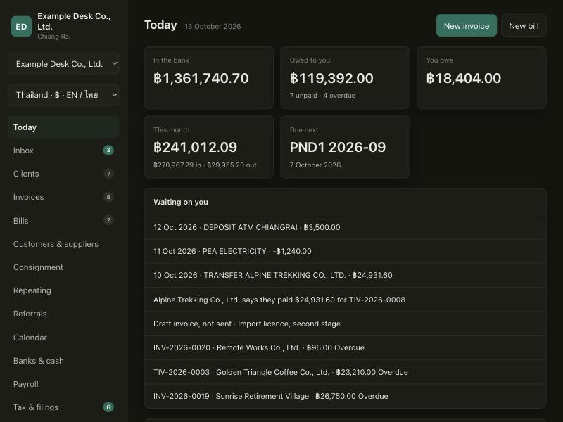

# Books demo

Double-entry books in a browser, with a sample company already in them. English with Thai, or English with Khmer.

Live: https://nanobotco.github.io/books-demo/



## Countries

The country menu in the sidebar switches the sample. Each country is a pack of dated rates and rules, and a pack is a file.

| | Thailand | Cambodia |
|---|---|---|
| Sample | a visa desk in Chiang Rai with seven lines of work | a bookkeeping practice in Phnom Penh with four client companies |
| Currency | baht | riel, with dollars over the counter |
| VAT | 7% | 10% |
| Withholding on services | 3% | 15% resident |
| Social security | one rate, with a ceiling | three schemes on a banded wage |
| Languages | English, ไทย (Buddhist year) | English, ខ្មែរ (year turns at Khmer New Year) |

Laos and Myanmar packs exist in `app/lib/jurisdictions/` with every rate marked unconfirmed.

`?kh=1` on the address opens the Cambodian sample directly.

## What it does

Invoices and Thai tax invoices, payments with tax withheld, stock by the piece, repeating bills, payroll, referrals between desks, a filing calendar, banks in more than one currency, PromptPay QR, a client link with a four-field screen, a LINE message flow, and a file import that reads Buddhist years and Thai column headings. Rates and rules are editable with the date each starts.

All names, tax numbers, phone numbers, bank accounts and addresses in the sample are invented.

## Run it

It is static files.

```bash
python3 serve.py 4321   # then open http://localhost:4321/
```

GitHub Pages serves the repository root. The database is SQLite compiled to JavaScript (`vendor/sql-asm.js`, sql.js, MIT) and is saved in the browser's own storage; Start over restores the sample.

## Licence

MIT. See `LICENSE`; `vendor/sql.js-LICENSE` covers sql.js.
